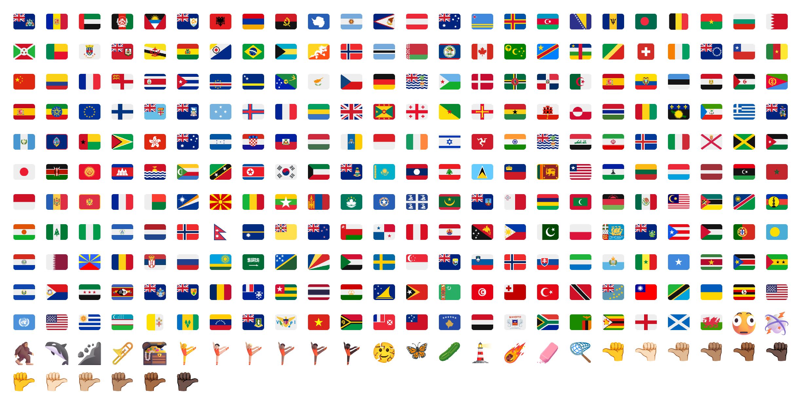

# 🚀 Flag Emoji for Windows Pro (`COLRv1` + `CBDT` Hybrid Engine)
**🌐 Language / Ngôn ngữ / 语言 / Язык:**  
🇺🇸 **English** | 🇻🇳 [Tiếng Việt](README.vi.md) | 🇨🇳 [中文 (Chinese)](README.zh.md) | 🇷🇺 [Русский (Russian)](README.ru.md)


> 🌐 **[Live Showcase (4 Languages)](https://github.io)** • 🔤 **Unicode 1.0 → 18.0** • 🪟 **Win11 Pure Hybrid (`13.59 MB`)** • 🖥️ **Ultra HD 8-Strike (`20→192px`)** • 📱 **Honor / Huawei `.hwt` Ready** • ✅ **Solves Issue #3**


**The Ultimate All-in-One Emoji Engine for Windows 11, Windows 10 & Android / Honor MagicOS.**  
Combines native Windows 11 **3D `COLRv1`** vectors with **7,079+ crisp `CBDT/CBLC` bitmaps**, **all 262 country & subdivision flags**, **3,136 native multi-skin-tone ZWJ sequences**, and **full Unicode 17.0 & 18.0** support in a clean, modular binary pipeline.

👉 **[Explore the 4-Language Interactive Showcase & Debug Gallery](https://github.io)**

---

## ✨ Core Architectural Breakthroughs

1. **Pure PC Hybrid Mode (`--pc-hybrid` — `13.59 MB`):**  
   Instead of bloating Windows 11 fonts with redundant bitmaps, `--pc-hybrid` builds a minimal 1-glyph `CBDT` shell (`12.34 MB`) and injects only the **262 missing flags + Unicode 18.0** (`13.59 MB` final)—preserving **100% lossless native `COLRv1` vectors** for all built-in Windows 11 emojis and ZWJ sequences.
2. **Cracking the 65,535 OpenType Glyph Ceiling (Slot Recycling):**  
   Harvests unused internal `COLR` component slots (`recyclable_step1`) to pack **3,136 dynamic multi-person & multi-skin-tone ZWJ sequences** (*Neutrals Holding Hands `🧑🏻‍🤝‍🧑🏼`*, *Fight Cloud `👩🏿‍  ‍👩🏾`*, *Bunny Ears `👩🏿‍🐰‍👩🏾`*, *Wrestling `👩🏿‍🤼‍👩🏾`*, *Ballet Dancers `🧑🏻‍🩰`*) + **262 flags** + **Unicode 18.0** safely under the 16-bit OpenType limit (`65,527 / 65,535` glyphs).
3. **Apple + Noto Ultra HD 8-Strike (`20 → 192px`):**  
   `make_apple_multistrike.py` strips `COLR/CPAL` and parallel-downscales a master `192px` font into **8 crisp PPEM strikes (`20, 32, 40, 48, 64, 96, 160, 192 px`)**—surpassing Apple Color Emoji's 7-strike ceiling for 2K/4K displays.
4. **MagicOS / Android System Fallback Mastery (`FALLBACK_CHARS`):**  
   Syncs `VS16` (`U+FE0F`) into **`cmap` Format 14 (UVS)** for mobile keyboards while stripping text arrows (`→`, `➔`, `➜`, `⇒`) and dashes (`—`, `–`, `―`) from `cmap`—triggering Android's native system font fallback so chat punctuation never renders blank.

> **100% Solves [Chasmical/flag-emojis-for-windows#3](https://github.com):** Full HarfBuzz + Skia rasterization of every dynamic multi-skin-tone ZWJ sequence in Windows 11!

---

## 📦 4 Optimized Release Editions

| Edition | Target Platform | Build Time | Output Size | Technical Architecture |
| :--- | :--- | :---: | :---: | :--- |
| **Win11 Pure Hybrid** (`--pc-hybrid`) | **Windows 11 PC** | ~60s | **13.59 MB** | 100% native `COLRv1` vectors for Win11 emojis/ZWJ + `CBDT` for 262 flags & Unicode 18.0 |
| **Win10 / Full Hybrid** (`109px`) | **Windows 10 & Legacy Apps** | ~5m | **40.94 MB** | Full `COLRv1` + **7,079** `109px` 3D bitmaps (3,136 ZWJ families + 262 flags + U18.0) |
| **Ultra HD 8-Strike** (`20 → 192px`) | **2K/4K Displays (Apple-Style)** | ~7m | **~110 MB** | Pure bitmap 3D across **8 strikes (`20, 32, 40, 48, 64, 96, 160, 192 px`)**, zero `COLR` |
| **Honor / Huawei `.hwt`** | **MagicOS / EMUI (Android)** | ~5s | **31.94 MB** | **7,079** 3D bitmaps + **342 `VS16`** Format 14 + **6,144 `GSUB`** rules + System Fallback |

---

## 🚀 Quick Start & CLI Usage

### 1. Install Dependencies
Place `seguiemj.ttf` (Windows 11), `NotoColorEmoji.ttf` (CBDT U18.0), `Twemoji.Mozilla_cbdt.ttf` (262 flags), and `template.hwt` (for Honor `.hwt`) in the project folder:
```bash
pip install -r requirements.txt
```

### 2. Build Windows 11 Pure Hybrid (`--pc-hybrid` — Recommended, `13.59 MB`)
```bash
python colr2cbdt_3d_skia.py seguiemj.ttf seguiemj_pc_base.ttf --pc-hybrid
python add_emoji_smart_cbdt_pro.py seguiemj_pc_base.ttf NotoColorEmoji.ttf Twemoji.Mozilla_cbdt.ttf seguiemj_win11_hybrid.ttf
```

### 3. Build Full 3D Pack + Honor / Huawei `.hwt` Theme
```bash
python colr2cbdt_3d_skia.py seguiemj.ttf seguiemj_3d_pro.ttf
python add_emoji_smart_cbdt_pro.py seguiemj_3d_pro.ttf NotoColorEmoji.ttf Twemoji.Mozilla_cbdt.ttf seguiemj_3d_pro_final.ttf
python merge_emoji_into_honor_font_pro.py template.hwt seguiemj_3d_pro_final.ttf Win11_3D_Honor.hwt
```

### 4. Build Apple + Noto Ultra HD 8-Strike (`20, 32, 40, 48, 64, 96, 160, 192 px`)
```bash
python colr2cbdt_3d_skia.py seguiemj.ttf seguiemj_192_base.ttf --ppem 192 --strip-colr
python add_emoji_smart_cbdt_pro.py seguiemj_192_base.ttf NotoColorEmoji.ttf Twemoji.Mozilla_cbdt.ttf seguiemj_192_final.ttf
python make_apple_multistrike.py seguiemj_192_final.ttf Win11_Ultra8Strikes_3D.ttf
```

---

## 💻 How to Install

* **Windows 11 / 10 (Safe `.reg` Registry Method — Recommended):**
  1. Right-click your chosen font (`seguiemj_win11_hybrid.ttf`, `seguiemj_3d_pro_final.ttf`, or `Win11_Ultra8Strikes_3D.ttf`) → **Install for all users** (so Windows copies it into `C:\Windows\Fonts\`).
  2. Double-click `Install_Win11_Hybrid_Emoji.reg` (points `"Segoe UI Emoji (TrueType)"` in `HKLM\SOFTWARE\Microsoft\Windows NT\CurrentVersion\Fonts` to the new font without overwriting Microsoft's protected system file) and restart your PC or browser.
  3. To revert anytime, simply double-click `Restore_Default_SegoeUIEmoji.reg`.
* **Honor / Huawei (MagicOS / EMUI):**  
  Copy `Win11_3D_Honor.hwt` into `Internal Storage/Honor/Themes/` (or `Huawei/Themes/`), open the **Themes** app → **Me** → **Themes**, and tap **Apply**.

---

## 🙏 Acknowledgments & Supporting Tools

This project was made possible thanks to the incredible open-source libraries, development tools, and AI assistants below:

### 1. Core Libraries & Open-Source Projects
* **[FontTools](https://github.com)** — Created by **Just van Rossum** and maintained by **Behdad Esfahbod** & the **Google Fonts** team; used for binary manipulation of OpenType/TrueType tables (`COLR`, `CPAL`, `CBDT`, `CBLC`, `GSUB`, `cmap`).
* **[Skia](https://skia.org) & [skia-python](https://github.com)** — 2D graphics engine by **Google** (Python bindings by **Kota Yamaguchi**); used to rasterize `COLRv1` / `COLRv0` vector glyphs into high-resolution bitmaps.
* **[HarfBuzz](https://github.io) & [uHarfBuzz](https://github.com)** — Created by **Behdad Esfahbod**; OpenType text shaping engine used to compose multi-person and multi-skin-tone ZWJ sequences.
* **[pngquant](https://pngquant.org)** — Created by **Kornel Lesiński (PorneL)**; lossy PNG compressor reducing `CBDT` table sizes by up to 75% while preserving full alpha transparency.
* **[Pillow (PIL Fork)](https://python-pillow.org)** — Originally created by **Fredrik Lundh** (`PIL`) and maintained by **Jeffrey A. Clark (aclark4life)** & contributors; used for pixel-accurate bounding-box cropping, `LANCZOS` resampling, and `FASTOCTREE` mobile quantization.
* **[Chasmical/flag-emojis-for-windows](https://github.com)** — Created by **Chasmical**; original inspiration for bringing full flag emoji support to Windows.

### 2. Development Environments & Input Methods (PC & Mobile)
* **Windows PC:** **Notepad++** (high-speed source code editing) & **UniKey** (standard Vietnamese input method).
* **Android Mobile:** **Termux** & **Pydroid 3** (terminal and on-device Python runtime for instant testing), alongside **Vikey** & **Laban Key** (text input support throughout research and mobile debugging).

### 3. AI Assistants
* **Google Gemini**, **xAI Grok**, **OpenAI ChatGPT**, **ByteDance Dola AI**, and **Microsoft Copilot** — invaluable companions for analyzing OpenType binary structures, optimizing multi-threaded algorithms, and real-world cross-platform testing on Windows and Android.

