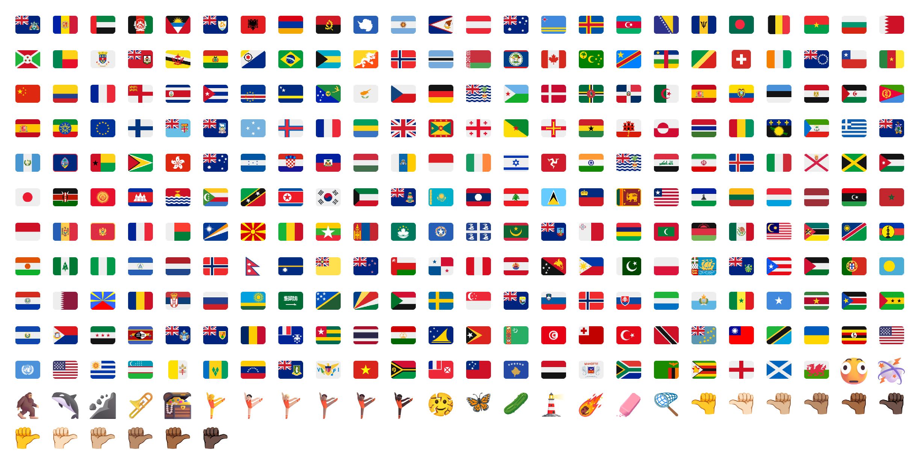

# 🚀 Flag Emoji for Windows Pro (`COLRv1` + `CBDT` Гибридный движок)

**🌐 Язык / Language / Ngôn ngữ / 语言:**  
🇺🇸 [English](README.md) | 🇻🇳 [Tiếng Việt](README.vi.md) | 🇨🇳 [中文 (Chinese)](README.zh.md) | 🇷🇺 **Русский (Russian)**


<div align="center">
  <p>
    <a href="https://github.com/tuannvbg/flag-emoji-for-windows-pro/releases">
      
    </a>
    <a href="https://github.com/tuannvbg/flag-emoji-for-windows-pro/stargazers">
      
    </a>
    <a href="https://github.com/tuannvbg/flag-emoji-for-windows-pro/subscription">
      
    </a>
    <a href="https://github.com/tuannvbg/flag-emoji-for-windows-pro/forks">
      
    </a>
</p>
</div>

**Универсальный движок эмодзи для Windows 11, Windows 10 и Android / Honor MagicOS.**  
Объединяет нативные векторы **3D `COLRv1`** из Windows 11 с **7 079+ четкими битмапами `CBDT/CBLC`**, **всеми 262 флагами стран и регионов**, **3 136 нативными ZWJ-последовательностями с разными оттенками кожи** и полной поддержкой **Unicode 17.0 и 18.0**.

👉 **[Открыть 4-язычную интерактивную витрину и галерею отладки](https://github.io)**

---

## ✨ Ключевые архитектурные прорывы

1. **Режим Pure PC Hybrid (`--pc-hybrid` — `13.59 МБ`):**  
   Вместо раздувания шрифта Windows 11 лишними растрами, `--pc-hybrid` создает минимальную оболочку `CBDT` на 1 эталонный глиф (`12.34 МБ`) и внедряет только недостающие **262 флага + Unicode 18.0** (`13.59 МБ` в итоге) — сохраняя **100% нативные векторы `COLRv1`** для всех встроенных эмодзи и ZWJ-серий Windows 11.
2. **Преодоление лимита 65 535 глифов OpenType (переработка слотов):**  
   Использует неиспользуемые внутренние слоты компонентов `COLR` (`recyclable_step1`), чтобы уместить **3 136 динамических ZWJ-последовательностей** (*Держащиеся за руки с разными оттенками кожи `🧑🏻‍🤝‍🧑🏼`*, *Облако драки `👩🏿‍  ‍👩🏾`*, *Танцовщицы с ушками кролика `👩🏿‍🐰‍👩🏾`*, *Борцы `👩🏿‍🤼‍👩🏾`*, *Балерины `🧑🏻‍🩰`*) + **262 флага** + **Unicode 18.0** безопасно в пределах 16-битного лимита OpenType (`65 527 / 65 535` глифов).
3. **Apple + Noto Ultra HD 8-Strike (`20 → 192px`):**  
   Скрипт `make_apple_multistrike.py` удаляет `COLR/CPAL` и в многопоточном режиме масштабирует мастер-шрифт `192px` в **8 четких размеров PPEM (`20, 32, 40, 48, 64, 96, 160, 192 px`)** — превосходя 7-уровневый лимит Apple Color Emoji для экранов 2K/4K.
4. **Нативный System Fallback на Honor MagicOS / Android (`FALLBACK_CHARS`):**  
   Синхронизирует `VS16` (`U+FE0F`) в таблицу **`cmap` Format 14 (UVS)** для мобильных клавиатур и удаляет текстовые стрелки (`→`, `➔`, `➜`, `⇒`) и тире (`—`, `–`, `―`) из `cmap` — активируя штатный системный fallback Android, чтобы знаки препинания в чатах никогда не пропадали.

> **На 100% решает [Chasmical/flag-emojis-for-windows#3](https://github.com):** Преодолевает лимит 65 535 глифов OpenType и обеспечивает полную поддержку ZWJ с разными оттенками кожи для **Unicode 17.0, 18.0 и будущих версий** с помощью HarfBuzz + Skia и умной переработки слотов!

---

## 📦 4 оптимизированные редакции

| Редакция | Целевая платформа | Время сборки | Размер | Техническая архитектура |
| :--- | :--- | :---: | :---: | :--- |
| **Win11 Pure Hybrid** (`--pc-hybrid`) | **Windows 11 ПК** | ~60 сек | **13.59 МБ** | 100% нативные векторы `COLRv1` для Win11 + `CBDT` для 262 флагов и Unicode 18.0 |
| **Win10 / Full Hybrid** (`109px`) | **Windows 10 и старые ПО** | ~5 мин | **40.94 МБ** | Полный `COLRv1` + **7 079** 3D-битмапов `109px` (3 136 ZWJ + 262 флага + U18.0) |
| **Ultra HD 8-Strike** (`20 → 192px`) | **Экраны 2K/4K (как Apple)** | ~7 мин | **~110 МБ** | Чистый растр 3D в **8 размерах (`20, 32, 40, 48, 64, 96, 160, 192 px`)**, без `COLR` |
| **Honor / Huawei `.hwt`** | **MagicOS / EMUI (Android)** | ~5 сек | **31.94 МБ** | **7 079** 3D-битмапов + **342 `VS16`** Format 14 + **6 144 `GSUB`** правил + System Fallback |

---

## 🚀 Быстрый старт и команды CLI

### 1. Установка зависимостей
Поместите `seguiemj.ttf` (Windows 11), `NotoColorEmoji.ttf` (CBDT U18.0), `Twemoji.Mozilla_cbdt.ttf` (262 флага) и `template.hwt` (для темы Honor) в папку проекта:
```bash
pip install -r requirements.txt
```

### 2. Сборка Windows 11 Pure Hybrid (`--pc-hybrid` — рекомендуется, `13.59 МБ`)
```bash
python colr2cbdt_3d_skia.py seguiemj.ttf seguiemj_pc_base.ttf --pc-hybrid
python add_emoji_smart_cbdt_pro.py seguiemj_pc_base.ttf NotoColorEmoji.ttf Twemoji.Mozilla_cbdt.ttf seguiemj_win11_hybrid.ttf
```

### 3. Сборка полного 3D-пакета и темы Honor / Huawei `.hwt`
```bash
python colr2cbdt_3d_skia.py seguiemj.ttf seguiemj_3d_pro.ttf
python add_emoji_smart_cbdt_pro.py seguiemj_3d_pro.ttf NotoColorEmoji.ttf Twemoji.Mozilla_cbdt.ttf seguiemj_3d_pro_final.ttf
python merge_emoji_into_honor_font_pro.py template.hwt seguiemj_3d_pro_final.ttf Win11_3D_Honor.hwt
```

### 4. Сборка Apple + Noto Ultra HD 8-Strike (`20, 32, 40, 48, 64, 96, 160, 192 px`)
```bash
python colr2cbdt_3d_skia.py seguiemj.ttf seguiemj_192_base.ttf --ppem 192 --strip-colr
python add_emoji_smart_cbdt_pro.py seguiemj_192_base.ttf NotoColorEmoji.ttf Twemoji.Mozilla_cbdt.ttf seguiemj_192_final.ttf
python make_apple_multistrike.py seguiemj_192_final.ttf Win11_Ultra8Strikes_3D.ttf
```

---

## 💻 Инструкция по установке

* **Windows 11 / 10 (безопасный метод через `.reg` — рекомендуется):**
  1. Нажмите правой кнопкой мыши на выбранный файл шрифта (`seguiemj_win11_hybrid.ttf`, `seguiemj_3d_pro_final.ttf` или `Win11_Ultra8Strikes_3D.ttf`) → выберите **Установить для всех пользователей (Install for all users)**, чтобы система скопировала его в `C:\Windows\Fonts\`.
  2. Дважды щелкните по файлу `Install_Win11_Hybrid_Emoji.reg` (перенаправляет ключ `"Segoe UI Emoji (TrueType)"` в `HKLM\SOFTWARE\Microsoft\Windows NT\CurrentVersion\Fonts` на новый шрифт без перезаписи защищенного системного файла Microsoft) и перезагрузите ПК или браузер.
  3. Чтобы вернуться к стандартному шрифту, просто запустите `Restore_Default_SegoeUIEmoji.reg`.
* **Honor / Huawei (MagicOS / EMUI):**  
  Скопируйте `Win11_3D_Honor.hwt` в папку `Внутренняя память/Honor/Themes/` (или `Huawei/Themes/`), откройте приложение **Темы (Themes)** → **Я (Me)** → **Темы (Themes)** и нажмите **Применить (Apply)**.

---

## 🙏 Благодарности и используемые инструменты

Проект стал возможен благодаря следующим библиотекам с открытым исходным кодом, инструментам разработки и ИИ-помощникам:

### 1. Основные библиотеки и Open-Source проекты
* **[FontTools](https://github.com)** — создан **Юстом ван Россумом (Just van Rossum)**, поддерживается **Бехдадом Эсфахбодом (Behdad Esfahbod)** и командой **Google Fonts**; используется для работы с бинарными таблицами OpenType/TrueType (`COLR`, `CPAL`, `CBDT`, `CBLC`, `GSUB`, `cmap`).
* **[Skia](https://skia.org) & [skia-python](https://github.com)** — 2D-графический движок от **Google** (Python-биндинги от **Коты Ямагути / Kota Yamaguchi**); используется для растеризации векторных глифов `COLRv1` / `COLRv0` в растры высокого разрешения.
* **[HarfBuzz](https://github.io) & [uHarfBuzz](https://github.com)** — создан **Бехдадом Эсфахбодом (Behdad Esfahbod)**; движок шейпинга текста OpenType для сборки сложных ZWJ-последовательностей с несколькими людьми и оттенками кожи.
* **[pngquant](https://pngquant.org)** — создан **Корнелом Лесиньским (Kornel Lesiński / PorneL)**; компрессор PNG с потерями, уменьшающий размер таблицы `CBDT` до 75% с полным сохранением альфа-канала прозрачности.
* **[Pillow (PIL Fork)](https://python-pillow.org)** — изначально создан **Фредриком Лундом (Fredrik Lundh)** (`PIL`), поддерживается **Джеффри А. Кларком (Jeffrey A. Clark / aclark4life)** и сообществом; используется для попиксельной обрезки границ, ресемплинга `LANCZOS` и квантования `FASTOCTREE` на мобильных устройствах.
* **[Chasmical/flag-emojis-for-windows](https://github.com)** — создан **Chasmical**; первоначальное вдохновение для добавления всех флагов в Windows.

### 2. Среды разработки и клавиатуры (ПК и мобильные устройства)
* **Windows ПК:** **Notepad++** (быстрое редактирование исходного кода) и **UniKey** (стандартная вьетнамская клавиатура).
* **Android Mobile:** **Termux** и **Pydroid 3** (терминал и среда выполнения Python прямо на смартфоне для мгновенной отладки), а также **Vikey** и **Laban Key** (удобный ввод текста во время исследований и мобильного тестирования).

### 3. ИИ-помощники
* **Google Gemini**, **xAI Grok**, **OpenAI ChatGPT**, **ByteDance Dola AI** и **Microsoft Copilot** — незаменимые помощники в анализе бинарных структур OpenType, оптимизации многопоточных алгоритмов и реальном кроссплатформенном тестировании на Windows и Android.

* ## ⚖️ Авторские права на графику и исследовательское назначение

* **Исходный код (`MIT License`):** Все Python-скрипты сборки, инструменты работы с бинарными таблицами OpenType и веб-интерфейс в данном репозитории распространяются под лицензией **MIT License**.
* **Права на оригинальную графику эмодзи:**
  * Графика **Windows 11 Fluent 3D Emoji** (`Segoe UI Emoji`) принадлежит **Microsoft Corporation**.
  * Графика **Noto Color Emoji** и **Blobmoji** принадлежит **Google LLC** (Apache 2.0 / SIL OFL).
  * Графика **Twemoji** принадлежит **Twitter / X Corp** и участникам **jdecked/twemoji** (CC-BY 4.0).
  * Графика **OpenMoji** принадлежит **OpenMoji** (CC-BY-SA 4.0).
  * **Проприетарные наборы эмодзи (перспективные исследования и обучение):** Любые будущие экспериментальные инструменты совместимости с **Apple Color Emoji** (Apple Inc.), **JoyPixels** (JoyPixels Inc.), **Samsung One UI Emoji** (Samsung Electronics), **WhatsApp Emoji** или **Facebook Emoji** предназначены **исключительно для личного обучения, тестирования совместимости и исследования инженерии шрифтов**. Все товарные знаки и авторские права на графику принадлежат их законным правообладателям.

