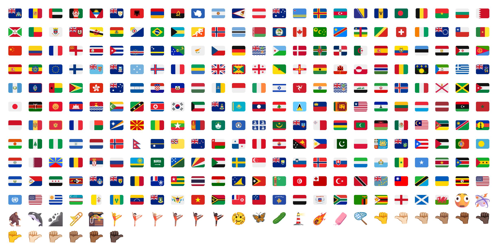

# 🚀 Flag Emoji for Windows Pro (`COLRv1` + `CBDT` Hybrid Engine)

**🌐 Ngôn ngữ / Language / 语言 / Язык:**  
🇺🇸 [English](README.md) | 🇻🇳 **Tiếng Việt** | 🇨🇳 [中文 (Chinese)](README.zh.md) | 🇷🇺 [Русский (Russian)](README.ru.md)


<div align="center">
  <p>
    <a href="https://github.com/tuannvbg/flag-emoji-for-windows-pro/releases">
      
    </a>
    <a href="https://github.com/tuannvbg/flag-emoji-for-windows-pro/stargazers">
      
    </a>
    <a href="https://github.com/tuannvbg/flag-emoji-for-windows-pro/subscription">
      
    </a>
    <a href="https://github.com/tuannvbg/flag-emoji-for-windows-pro/forks">
      
    </a>
</p>
</div>

**Bộ công cụ toàn diện giúp mang trọn bộ 262 quốc kỳ, hiệu ứng Fluent 3D của Windows 11 và chuẩn Unicode 17.0 / 18.0 lên Windows 11, Windows 10 và điện thoại Honor / Huawei (MagicOS / EMUI).**  
Kết hợp giữa vector **3D `COLRv1`** nguyên bản của Microsoft với **7.079+ ảnh bitmap `CBDT/CBLC`** sắc nét, **3.136 tổ hợp gia đình/cặp đôi ZWJ đa tông da**, trong một quy trình xử lý nhị phân gọn gàng, sạch sẽ.

👉 **[Xem Trang Giới Thiệu 4 Ngôn Ngữ & Thư Viện Ảnh Kiểm Chứng Thực Tế](https://github.io)**

---

## ✨ Những Đột Phá Kiến Trúc Cốt Lõi

1. **Chế Độ Pure PC Hybrid (`--pc-hybrid` — `13.59 MB`):**  
   Thay vì làm phình dung lượng font trên Windows 11 bằng hàng nghìn ảnh thừa, `--pc-hybrid` chỉ tạo một vỏ bảng `CBDT` tối giản từ 1 glyph mẫu (`12.34 MB`) và cấy đúng phần còn thiếu là **262 quốc kỳ + Full Unicode 18.0** (`13.59 MB` thành phẩm) — giữ nguyên **100% vector `COLRv1` gốc** cho mọi emoji và tổ hợp ZWJ có sẵn của Windows 11.
2. **Phá Vỡ Trần 65.535 Glyph OpenType (Thuật Toán Tái Chế Slot):**  
   Tận dụng các ô glyph thành phần `COLR` ẩn không dùng tới (`recyclable_step1`) để chứa trọn **3.136 chuỗi ZWJ đa người & đa tông da** (*Cặp đôi trung tính nắm tay `🧑🏻‍🤝‍🧑🏼`*, *Đám mây đánh nhau `👩🏿‍  ‍👩🏾`*, *Người đeo tai thỏ `👩🏿‍🐰‍👩🏾`*, *Đấu vật `👩🏿‍🤼‍👩🏾`*, *Vũ công ba-lê `🧑🏻‍🩰`*) + **262 lá cờ** + **Unicode 18.0**, khóa chặt tổng số glyph dưới giới hạn 16-bit (`65.527 / 65.535` glyphs).
3. **Bản Ultra HD 8 Mức Chuẩn Apple + Noto (`20 → 192px`):**  
   Công cụ `make_apple_multistrike.py` xóa sạch bảng `COLR/CPAL` và nội suy đa luồng từ bản gốc `192px` ra đủ **8 mức độ phân giải (`20, 32, 40, 48, 64, 96, 160, 192 px`)** — vượt qua giới hạn 7 mức của Apple Color Emoji để hiển thị sắc nét tuyệt đối trên màn hình 2K/4K.
4. **Bí Quyết System Fallback Trên Honor MagicOS / Android (`FALLBACK_CHARS`):**  
   Đồng bộ `VS16` (`U+FE0F`) vào bảng **`cmap` Format 14 (UVS)** giúp bàn phím di động không bị thiếu icon, đồng thời gỡ bỏ các mũi tên văn bản (`→`, `➔`, `➜`, `⇒`) và dấu gạch ngang (`—`, `–`, `―`) khỏi `cmap` — kích hoạt cơ chế fallback tự nhiên của Android giúp dấu câu trong tin nhắn không bao giờ bị biến thành khoảng trắng.

> **Giải quyết 100% [Chasmical/flag-emojis-for-windows#3](https://github.com):** Định hình qua HarfBuzz và render bằng Skia trọn vẹn mọi chuỗi ZWJ đa tông da của Windows 11!

---

## 📦 4 Phiên Bản Phát Hành Tối Ưu

| Phiên bản | Nền tảng mục tiêu | Thời gian build | Dung lượng | Kiến trúc kỹ thuật |
| :--- | :--- | :---: | :---: | :--- |
| **Win11 Pure Hybrid** (`--pc-hybrid`) | **Windows 11 PC** | ~60 giây | **13.59 MB** | 100% vector `COLRv1` gốc cho emoji Win11/ZWJ + `CBDT` cho 262 cờ & Unicode 18.0 |
| **Win10 / Full Hybrid** (`109px`) | **Windows 10 & Ứng dụng cũ** | ~5 phút | **40.94 MB** | Đầy đủ `COLRv1` + **7.079** ảnh 3D `109px` (3.136 chuỗi ZWJ + 262 cờ + U18.0) |
| **Ultra HD 8-Strike** (`20 → 192px`) | **Màn hình 2K/4K (Chuẩn Apple)** | ~7 phút | **~110 MB** | Thuần bitmap 3D đủ **8 mức (`20, 32, 40, 48, 64, 96, 160, 192 px`)**, xóa sạch `COLR` |
| **Honor / Huawei `.hwt`** | **MagicOS / EMUI (Android)** | ~5 giây | **31.94 MB** | **7.079** ảnh 3D + **342 `VS16`** Format 14 + **6.144 `GSUB`** rules + System Fallback |

---

## 🚀 Hướng Dẫn Build Nhanh (CLI)

### 1. Cài Đặt Thư Viện
Đặt sẵn `seguiemj.ttf` (Windows 11), `NotoColorEmoji.ttf` (CBDT U18.0), `Twemoji.Mozilla_cbdt.ttf` (262 cờ) và `template.hwt` (nếu đóng gói cho Honor) vào thư mục dự án:
```bash
pip install -r requirements.txt
```

### 2. Build Bản Windows 11 Pure Hybrid (`--pc-hybrid` — Khuyên dùng, `13.59 MB`)
```bash
python colr2cbdt_3d_skia.py seguiemj.ttf seguiemj_pc_base.ttf --pc-hybrid
python add_emoji_smart_cbdt_pro.py seguiemj_pc_base.ttf NotoColorEmoji.ttf Twemoji.Mozilla_cbdt.ttf seguiemj_win11_hybrid.ttf
```

### 3. Build Bản Full 3D & Theme Honor / Huawei `.hwt`
```bash
python colr2cbdt_3d_skia.py seguiemj.ttf seguiemj_3d_pro.ttf
python add_emoji_smart_cbdt_pro.py seguiemj_3d_pro.ttf NotoColorEmoji.ttf Twemoji.Mozilla_cbdt.ttf seguiemj_3d_pro_final.ttf
python merge_emoji_into_honor_font_pro.py template.hwt seguiemj_3d_pro_final.ttf Win11_3D_Honor.hwt
```

### 4. Build Bản Apple + Noto Ultra HD 8 Mức (`20, 32, 40, 48, 64, 96, 160, 192 px`)
```bash
python colr2cbdt_3d_skia.py seguiemj.ttf seguiemj_192_base.ttf --ppem 192 --strip-colr
python add_emoji_smart_cbdt_pro.py seguiemj_192_base.ttf NotoColorEmoji.ttf Twemoji.Mozilla_cbdt.ttf seguiemj_192_final.ttf
python make_apple_multistrike.py seguiemj_192_final.ttf Win11_Ultra8Strikes_3D.ttf
```

---

## 💻 Cách Cài Đặt

* **Windows 11 / 10 (Cài bằng file `.reg` an toàn — Khuyên dùng):**
  1. Nhấn chuột phải vào file font bạn chọn (`seguiemj_win11_hybrid.ttf`, `seguiemj_3d_pro_final.ttf` hoặc `Win11_Ultra8Strikes_3D.ttf`) → chọn **Install for all users** (để Windows tự chép file vào `C:\Windows\Fonts\`).
  2. Chạy file `Install_Win11_Hybrid_Emoji.reg` (trỏ khóa `"Segoe UI Emoji (TrueType)"` trong `HKLM\SOFTWARE\Microsoft\Windows NT\CurrentVersion\Fonts` sang tên font mới mà **không cần ghi đè file hệ thống gốc** của Microsoft) rồi khởi động lại máy hoặc trình duyệt.
  3. Khi muốn quay về mặc định, chỉ cần bấm đúp vào file `Restore_Default_SegoeUIEmoji.reg`.
* **Honor / Huawei (MagicOS / EMUI):**  
  Chép file `Win11_3D_Honor.hwt` vào thư mục `Bộ nhớ trong/Honor/Themes/` (hoặc `Huawei/Themes/`), mở ứng dụng **Chủ đề (Themes)** → **Tôi (Me)** → **Chủ đề (Themes)** và nhấn **Áp dụng (Apply)**.
---

## 🙏 Lời Cảm Ơn & Công Cụ Hỗ Trợ

Dự án được hoàn thiện nhờ sự đóng góp tuyệt vời của các thư viện mã nguồn mở, công cụ phát triển và các trợ lý AI sau:

### 1. Thư Viện Lõi & Mã Nguồn Mở
* **[FontTools](https://github.com)** — Sáng lập bởi **Just van Rossum**, duy trì bởi **Behdad Esfahbod** & đội ngũ **Google Fonts**; dùng để xử lý nhị phân các bảng OpenType/TrueType (`COLR`, `CPAL`, `CBDT`, `CBLC`, `GSUB`, `cmap`).
* **[Skia](https://skia.org) & [skia-python](https://github.com)** — Bộ máy đồ họa 2D của **Google** (Python binding bởi **Kota Yamaguchi**); dùng để render vector `COLRv1` / `COLRv0` thành ảnh bitmap độ phân giải cao.
* **[HarfBuzz](https://github.io) & [uHarfBuzz](https://github.com)** — Sáng lập bởi **Behdad Esfahbod**; bộ máy định hình văn bản OpenType dùng để ghép các chuỗi ZWJ đa người và đa tông da.
* **[pngquant](https://pngquant.org)** — Sáng lập bởi **Kornel Lesiński (PorneL)**; công cụ nén PNG giúp giảm tới 75% dung lượng bảng `CBDT` mà vẫn giữ nguyên độ trong suốt alpha.
* **[Pillow (PIL Fork)](https://python-pillow.org)** — Khởi xướng bởi **Fredrik Lundh** (`PIL`), duy trì bởi **Jeffrey A. Clark (aclark4life)** & cộng đồng; dùng để cắt khung ảnh chuẩn từng pixel, nội suy `LANCZOS` và nén `FASTOCTREE` trên di động.
* **[Chasmical/flag-emojis-for-windows](https://github.com)** — Tạo bởi **Chasmical**; nguồn cảm hứng ban đầu cho việc mang trọn bộ quốc kỳ lên Windows.

### 2. Công Cụ Lập Trình & Bộ Gõ (PC & Mobile)
* **Windows PC:** **Notepad++** (soạn thảo & chỉnh sửa mã nguồn tốc độ cao) & **UniKey** (bộ gõ tiếng Việt chuẩn mực).
* **Android Mobile:** **Termux** & **Pydroid 3** (môi trường dòng lệnh & chạy Python trực tiếp trên điện thoại để kiểm thử tức thì), cùng **Vikey** & **Laban Key** (hỗ trợ nhập liệu trong suốt quá trình nghiên cứu và thử nghiệm).

## ⚖️ Bản Quyền Hình Ảnh & Tuyên Bố Nghiên Cứu

* **Mã nguồn công cụ (`MIT License`):** Toàn bộ các script Python, bộ xử lý bảng nhị phân OpenType và giao diện web trong kho mã này được phát hành theo giấy phép mã nguồn mở **MIT License**.
* **Bản quyền đồ họa Emoji gốc:**
  * Đồ họa **Windows 11 Fluent 3D Emoji** (`Segoe UI Emoji`) thuộc bản quyền của **Microsoft Corporation**.
  * Đồ họa **Noto Color Emoji** & **Blobmoji** thuộc bản quyền của **Google LLC** (Apache 2.0 / SIL OFL).
  * Đồ họa **Twemoji** thuộc bản quyền của **Twitter / X Corp** & cộng đồng **jdecked/twemoji** (CC-BY 4.0).
  * Đồ họa **OpenMoji** thuộc bản quyền của **OpenMoji** (CC-BY-SA 4.0).
  * **Các bộ Emoji nguồn đóng (Định hướng mở rộng cho Học tập & Nghiên cứu):** Mọi công cụ thử nghiệm tương thích với **Apple Color Emoji** (Apple Inc.), **JoyPixels** (JoyPixels Inc.), **Samsung One UI Emoji** (Samsung Electronics), **WhatsApp Emoji** hay **Facebook Emoji** trong tương lai chỉ phục vụ **mục đích học tập cá nhân, kiểm thử tương thích và nghiên cứu kỹ thuật cấu trúc font**. Toàn bộ nhãn hiệu và bản quyền thiết kế gốc thuộc về các chủ sở hữu tương ứng.

### 3. Các Trợ Lý AI Đồng Hành
* **Google Gemini**, **xAI Grok**, **OpenAI ChatGPT**, **ByteDance Dola AI** và **Microsoft Copilot** — những người bạn đồng hành đắc lực trong việc phân tích cấu trúc nhị phân OpenType, tối ưu thuật toán đa luồng và kiểm thử thực tế trên cả Windows lẫn Android.

