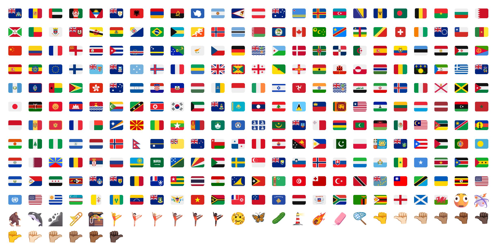

# 🚀 Flag Emoji for Windows Pro (`COLRv1` + `CBDT` 混合表情引擎)

**🌐 语言 / Language / Ngôn ngữ / Язык:**  
🇺🇸 [English](README.md) | 🇻🇳 [Tiếng Việt](README.vi.md) | 🇨🇳 **中文 (Chinese)** | 🇷🇺 [Русский (Russian)](README.ru.md)


<div align="center">
  <p>
    <a href="https://github.com/tuannvbg/flag-emoji-for-windows-pro/releases">
      
    </a>
    <a href="https://github.com/tuannvbg/flag-emoji-for-windows-pro/stargazers">
      
    </a>
    <a href="https://github.com/tuannvbg/flag-emoji-for-windows-pro/subscription">
      
    </a>
    <a href="https://github.com/tuannvbg/flag-emoji-for-windows-pro/forks">
      
    </a>
</p>
</div>

**适用于 Windows 11、Windows 10 与 Android / 荣耀 MagicOS 的全能表情字体引擎。**  
在保留 Windows 11 原生 **3D `COLRv1`** 矢量的同时，无缝注入 **7,079+ 张高清 `CBDT/CBLC` 位图**、**全部 262 面国家与地区旗帜**、**3,136 个原生多肤色 ZWJ 序列**，以及完整的 **Unicode 17.0 & 18.0** 支持。

👉 **[访问 4 语言交互式展示页面与实机调试图库](https://github.io)**

---

## ✨ 核心架构突破

1. **PC 纯净混合模式 (`--pc-hybrid` — `13.59 MB`)：**  
   避免用冗余位图使 Windows 11 字体体积膨胀，`--pc-hybrid` 仅使用单个参考字形构建极简 `CBDT` 外壳（`12.34 MB`），并仅注入缺失的 **262 面旗帜 + Unicode 18.0**（最终仅 `13.59 MB`）——为 Windows 11 内置所有表情与 ZWJ 序列保留 **100% 无损原生 `COLRv1` 矢量**。
2. **突破 OpenType 65,535 字形上限（智能槽位回收算法）：**  
   回收字体内部闲置的 `COLR` 组件字形槽位（`recyclable_step1`），容纳全部 **3,136 个动态多人及多肤色 ZWJ 序列**（*不同肤色牵手 `🧑🏻‍🤝‍🧑🏼`*、*打斗烟云 `👩🏿‍  ‍👩🏾`*、*兔耳舞者 `👩🏿‍🐰‍👩🏾`*、*摔跤手 `👩🏿‍🤼‍👩🏾`*、*芭蕾舞者 `🧑🏻‍🩰`*）+ **262 面旗帜** + **Unicode 18.0**，安全锁定在 16 位 OpenType 上限之内（`65,527 / 65,535` 字形）。
3. **Apple + Noto 超清 8 级多分辨率版 (`20 → 192px`)：**  
   `make_apple_multistrike.py` 移除 `COLR/CPAL` 表，并将 `192px` 母版多线程缩放为 **8 个清晰 PPEM 分辨率（`20, 32, 40, 48, 64, 96, 160, 192 px`）**——超越 Apple Color Emoji 的 7 级上限，专为 2K/4K 高分屏打造。
4. **荣耀 MagicOS / Android 系统原生回退机制 (`FALLBACK_CHARS`)：**  
   将 `VS16` (`U+FE0F`) 同步至 **`cmap` Format 14 (UVS)** 以适配手机输入法，同时从 `cmap` 中移除文本箭头（`→`、`➔`、`➜`、`⇒`）与破折号（`—`、`–`、`―`）——触发 Android 原生系统字体回退，彻底消除聊天界面标点符号显示为空白的问题。

> **100% 解决 [Chasmical/flag-emojis-for-windows#3](https://github.com)：** 突破 OpenType 65,535 字形上限，通过 HarfBuzz + Skia 与智能槽位回收为 **Unicode 17.0、18.0 及未来版本**提供完整的多肤色 ZWJ 支持！

---

## 📦 四大优化发行版本

| 版本名称 | 适用平台 | 构建耗时 | 文件大小 | 技术架构亮点 |
| :--- | :--- | :---: | :---: | :--- |
| **Win11 纯净混合版** (`--pc-hybrid`) | **Windows 11 PC** | ~60 秒 | **13.59 MB** | Win11 原生表情/ZWJ 保留 100% `COLRv1` 矢量 + `CBDT` 承载 262 旗帜与 Unicode 18.0 |
| **Win10 / 完整混合版** (`109px`) | **Windows 10 与传统软件** | ~5 分钟 | **40.94 MB** | 完整 `COLRv1` + **7,079** 张 `109px` 3D 位图（3,136 组 ZWJ + 262 旗帜 + U18.0） |
| **超清 8 级分辨率版** (`20 → 192px`) | **2K/4K 高分屏 (仿 Apple)** | ~7 分钟 | **~110 MB** | 纯位图 3D 覆盖 **8 个尺寸（`20, 32, 40, 48, 64, 96, 160, 192 px`）**，零 `COLR` 表 |
| **荣耀 / 华为 `.hwt`** | **MagicOS / EMUI (Android)** | ~5 秒 | **31.94 MB** | **7,079** 张 3D 位图 + **342 `VS16`** Format 14 + **6,144 `GSUB`** 规则 + 系统原生回退 |

---

## 🚀 快速开始与命令行用法

### 1. 安装依赖库
将 `seguiemj.ttf` (Windows 11)、`NotoColorEmoji.ttf` (CBDT U18.0)、`Twemoji.Mozilla_cbdt.ttf` (262 面旗帜) 以及 `template.hwt` (制作荣耀主题需要) 放入项目目录：
```bash
pip install -r requirements.txt
```

### 2. 构建 Windows 11 纯净混合版 (`--pc-hybrid` — 推荐，`13.59 MB`)
```bash
python colr2cbdt_3d_skia.py seguiemj.ttf seguiemj_pc_base.ttf --pc-hybrid
python add_emoji_smart_cbdt_pro.py seguiemj_pc_base.ttf NotoColorEmoji.ttf Twemoji.Mozilla_cbdt.ttf seguiemj_win11_hybrid.ttf
```

### 3. 构建完整 3D 版与荣耀 / 华为 `.hwt` 主题
```bash
python colr2cbdt_3d_skia.py seguiemj.ttf seguiemj_3d_pro.ttf
python add_emoji_smart_cbdt_pro.py seguiemj_3d_pro.ttf NotoColorEmoji.ttf Twemoji.Mozilla_cbdt.ttf seguiemj_3d_pro_final.ttf
python merge_emoji_into_honor_font_pro.py template.hwt seguiemj_3d_pro_final.ttf Win11_3D_Honor.hwt
```

### 4. 构建 Apple + Noto 超清 8 级分辨率版 (`20, 32, 40, 48, 64, 96, 160, 192 px`)
```bash
python colr2cbdt_3d_skia.py seguiemj.ttf seguiemj_192_base.ttf --ppem 192 --strip-colr
python add_emoji_smart_cbdt_pro.py seguiemj_192_base.ttf NotoColorEmoji.ttf Twemoji.Mozilla_cbdt.ttf seguiemj_192_final.ttf
python make_apple_multistrike.py seguiemj_192_final.ttf Win11_Ultra8Strikes_3D.ttf
```

---

## 💻 安装指南

* **Windows 11 / 10（安全 `.reg` 注册表方式 — 推荐）：**
  1. 右键点击所选字体（`seguiemj_win11_hybrid.ttf`、`seguiemj_3d_pro_final.ttf` 或 `Win11_Ultra8Strikes_3D.ttf`）→ 选择 **为所有用户安装 (Install for all users)**（将其复制到 `C:\Windows\Fonts\`）。
  2. 双击运行 `Install_Win11_Hybrid_Emoji.reg`（将注册表 `HKLM\SOFTWARE\Microsoft\Windows NT\CurrentVersion\Fonts` 中的 `"Segoe UI Emoji (TrueType)"` 指向新字体，无需覆盖微软受保护的系统文件），然后重启电脑或浏览器即可生效。
  3. 如需恢复默认字体，只需双击运行 `Restore_Default_SegoeUIEmoji.reg`。
* **荣耀 / 华为 (MagicOS / EMUI)：**  
  将 `Win11_3D_Honor.hwt` 复制到手机 `内部存储/Honor/Themes/`（或 `Huawei/Themes/`），打开 **主题 (Themes)** 应用 → **我的 (Me)** → **主题 (Themes)** 并点击 **应用 (Apply)**。

---

## 🙏 致谢与支持工具

本项目的顺利完成离不开以下优秀的开源库、开发工具以及 AI 助手的支持：

### 1. 核心开源库与项目
* **[FontTools](https://github.com)** — 由 **Just van Rossum** 创建，**Behdad Esfahbod** 与 **Google Fonts** 团队维护；用于对 OpenType/TrueType 二进制表（`COLR`、`CPAL`、`CBDT`、`CBLC`、`GSUB`、`cmap`）进行底层操作。
* **[Skia](https://skia.org) & [skia-python](https://github.com)** — **Google** 开源 2D 图形引擎（Python 绑定由 **Kota Yamaguchi** 开发）；用于将 `COLRv1` / `COLRv0` 矢量字形光栅化为高分辨率位图。
* **[HarfBuzz](https://github.io) & [uHarfBuzz](https://github.com)** — 由 **Behdad Esfahbod** 创建；OpenType 文本塑形引擎，用于解析复杂的多人及多肤色 ZWJ 组合序列。
* **[pngquant](https://pngquant.org)** — 由 **Kornel Lesiński (PorneL)** 创建；有损 PNG 压缩器，在保留完整 Alpha 透明通道的同时将 `CBDT` 表体积减少高达 75%。
* **[Pillow (PIL Fork)](https://python-pillow.org)** — 最初由 **Fredrik Lundh** (`PIL`) 创建，现由 **Jeffrey A. Clark (aclark4life)** 及社区维护；用于像素级边界裁剪、`LANCZOS` 重采样及移动端 `FASTOCTREE` 量化。
* **[Chasmical/flag-emojis-for-windows](https://github.com)** — 由 **Chasmical** 创建；为 Windows 带来完整国旗表情支持的最初灵感来源。

### 2. 开发环境与输入法（PC 与移动端）
* **Windows PC：** **Notepad++**（高速源码编辑）与 **UniKey**（标准越南语输入法）。
* **Android 移动端：** **Termux** 与 **Pydroid 3**（手机端命令行与 Python 运行环境，实现即时调试），以及 **Vikey** 与 **Laban Key**（全程提供流畅的移动端输入支持）。

### 3. AI 助手
* **Google Gemini**、**xAI Grok**、**OpenAI ChatGPT**、**ByteDance Dola AI** 以及 **Microsoft Copilot** —— 在 OpenType 二进制结构分析、多线程算法优化以及 Windows 与 Android 跨平台实机测试中提供了强有力的协助。

## ⚖️ 图像版权与学术研究声明

* **工具源代码 (`MIT License`)：** 本仓库中的所有 Python 构建脚本、OpenType 二进制表处理程序及网页展示代码均采用 **MIT License** 开源许可。
* **原始表情图形版权归属：**
  * **Windows 11 Fluent 3D Emoji** (`Segoe UI Emoji`) 图形版权归 **Microsoft Corporation** 所有。
  * **Noto Color Emoji** 与 **Blobmoji** 图形版权归 **Google LLC** 所有（Apache 2.0 / SIL OFL）。
  * **Twemoji** 图形版权归 **Twitter / X Corp** 及 **jdecked/twemoji** 贡献者所有（CC-BY 4.0）。
  * **OpenMoji** 图形版权归 **OpenMoji** 所有（CC-BY-SA 4.0）。
  * **闭源商业表情包（未来学习与技术研究兼容方向）：** 未来任何涉及兼容 **Apple Color Emoji** (Apple Inc.)、**JoyPixels** (JoyPixels Inc.)、**Samsung One UI Emoji** (Samsung Electronics)、**WhatsApp Emoji** 或 **Facebook Emoji** 的实验性工具，均**仅限用于个人学习、跨平台兼容性测试及字体工程技术研究**。所有相关商标与原始美术版权均归其各自所有者独家享有。
